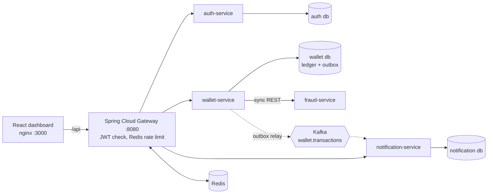

# Digital Wallet & Payments

A Spring Boot microservices wallet with a **double-entry ledger**, ACID transfers, idempotency keys, a rule-based fraud check, Kafka notifications through a transactional outbox, and a React dashboard.


[](https://github.com/Alkarim786/digital-wallet-payments/actions/workflows/ci.yml)

*Project 19 of Karim's 30 Days, 30 Projects series.*

## Problem

Moving money is the canonical "must not be wrong" workload: a retried request must not pay twice, two concurrent payments must not overdraw an account, a crash must not create or destroy money, and every cent must be traceable. This project implements those guarantees on PostgreSQL and proves them with concurrency tests, a database-enforced ledger invariant, and an independent reconciliation audit.

## Architecture



**Request path.** The browser calls `/api/...` on nginx, which proxies to the gateway. The gateway verifies the JWT once, **strips any client-supplied identity headers**, injects `X-User-Id` / `X-User-Role`, applies a per-user token bucket stored in Redis, rewrites the path, and forwards. Internal services trust only those headers and are not published to the host.

**A transfer** (`POST /api/wallet/transfers`, `Idempotency-Key` required):
1. Replay fast-path: a completed key returns the stored response with no work.
2. Features (payment velocity, first-time payee, country) are computed and sent to `fraud-service` **before** the database transaction, because holding row locks across a network call would serialise every payment touching a hot account behind a remote service.
3. One database transaction: claim the idempotency key (`INSERT ... ON CONFLICT DO NOTHING`) -> lock both accounts `FOR UPDATE` **in ascending id order** -> re-check funds under the lock -> insert the transaction, a DEBIT and a CREDIT entry -> update cached balances -> insert an outbox event -> store the response under the key.
4. An outbox relay publishes committed events to Kafka (at-least-once); `notification-service` consumes them idempotently and "emails" the users.

Fraud outcomes: `APPROVE` moves the money; `REVIEW` records a `HELD` transfer (no money moves) that an admin approves or rejects; `DECLINE` records a `DECLINED` transfer and returns `422`. If fraud-service is down or slow, transfers are **held for review** (not silently approved, not hard-failed).

## Tech stack

| Choice | Why |
|---|---|
| Java 21, Spring Boot 3.5 | per-service apps, `JdbcClient` for explicit SQL on the money path |
| Spring Cloud Gateway (WebFlux) | one place for auth, rate limiting and routing |
| PostgreSQL 16 | ACID, row locks, deferred constraint triggers, `ON CONFLICT` |
| Flyway | versioned schema including the ledger triggers |
| Kafka (KRaft) + transactional outbox | event exists iff the money moved; no dual-write |
| Redis | shared token-bucket rate limiter state |
| JJWT (HS256) | stateless edge authentication; shared `wallet-common` module |
| React 18 + TypeScript + Vite | dashboard, no chart library (hand-rolled SVG) |
| Testcontainers | integration tests against real Postgres, Kafka and Redis |

## Features

- Register/login, roles USER / ADMIN (admin cannot be self-registered; bootstrapped from config), BCrypt
- Wallet per user, simulated top-ups from a system funding account (so the sum of **all** balances is always 0)
- Double-entry ledger, integer minor units only, append-only entries
- Concurrency-safe transfers, idempotency keys with request-hash check, fraud rules with explainable scores, admin review queue
- Kafka outbox -> notification-service (idempotent consumer, poison-message safe)
- Dashboard: balance, send money, filterable/paginated history, daily + per-category analytics charts, notifications, admin queue + ledger health
- Admin ledger **reconciliation** endpoint (balances = sum of entries, every txn balances, global sum = 0)

## Roadmap (not built)

- Multi-currency with FX rates (the schema carries a currency column; transfers are USD only)
- Scheduled/recurring payments, 2FA, refresh tokens and token revocation
- Reduce DB round trips per transfer (single-statement CTE or stored procedure) and shard hot accounts
- Reservation of funds for held transfers (today a hold does not reserve; approval re-checks funds)

## Key engineering decisions and trade-offs

- **Money is `BIGINT` minor units.** No floats anywhere, including the UI (`parseToMinor` is string based).
- **The double-entry invariant lives in the database,** not just application code: a `DEFERRABLE INITIALLY DEFERRED` constraint trigger rejects any committed ledger transaction whose entries do not sum to zero; entries are append-only (update/delete trigger); a `CHECK` stops user balances going negative even if the app were wrong.
- **Deadlock avoidance, and a bug the tests caught.** Locking accounts in ascending id order prevents the classic A->B / B->A deadlock, but my first version still deadlocked under load: inserting the `transactions` row (foreign keys to both accounts) takes `FOR KEY SHARE` locks *before* the `FOR UPDATE`, and two transactions holding key-share locks that then both want `FOR UPDATE` wait on each other. The fix is to lock first, insert after (see `TransferService.lockPair`). The 1,500-transfer random concurrency test and the opposing-pair test now pass.
- **Idempotency.** The key is claimed inside the transfer transaction with `ON CONFLICT DO NOTHING`: a concurrent duplicate blocks until the first request commits, then replays its stored response (16 concurrent retries -> exactly one transfer). The same key with a different body returns `422`. Business errors like `INSUFFICIENT_FUNDS` roll everything back including the key, so the same key can be retried after topping up. Keys are scoped per user.
- **Outbox over dual-write.** Writing to Kafka inside the DB transaction cannot be atomic; the outbox row is. Relay uses `FOR UPDATE SKIP LOCKED`; delivery is at-least-once, so consumers deduplicate by `eventId`.
- **Fraud call outside the lock,** at the cost that velocity features can race (two concurrent requests may both see "4 recent transfers"). Documented, acceptable for a rule engine; the ledger itself is never at risk.
- **Gateway trust boundary.** Services trust `X-User-*` headers, so the gateway strips inbound copies (unit-tested) and compose publishes only the gateway and the web port.
- **Rate limiter fails open** when Redis is unavailable (Spring's default); a stricter deployment would fail closed on the money endpoints.
- **Country for the "blocked country" rule** comes from an `X-Country` request header here, which a client can spoof. In production it must come from edge GeoIP.

## Quick start

```bash
docker compose up --build        # postgres, redis, kafka, 5 Spring services, dashboard
# dashboard http://localhost:3000    gateway http://localhost:8080
python scripts/smoke.py          # end-to-end check through the gateway
```
Demo admin: `admin@wallet.example` / `admin-password-1` (set `ADMIN_EMAIL` / `ADMIN_PASSWORD` / `JWT_SECRET` in `.env`, see `.env.example`). Register two users in the UI, use **Add funds (demo)**, copy the second user's account number and send money.

### Local development
Requires JDK 21, Maven 3.9, Node 20, Docker (Testcontainers). Tools used on the build machine (Windows 11): JDK 21, Maven 3.9.16, Node 24, Docker Desktop.
```bash
mvn -B verify -Pit                 # all unit + integration tests (Docker required for -Pit)
mvn -B test                        # fast unit tests only
cd frontend && npm install && npm test && npm run dev   # Vite proxies /api to :8080
```
On Windows the root pom sets `-Djdk.net.unixdomain.tmpdir` (profile `windows`) to avoid the JDK "Unable to establish loopback connection" selector error.

## API reference (through the gateway)

| Method & path | Auth | Notes |
|---|---|---|
| `POST /api/auth/register`, `/api/auth/login` | public | `{"email","password"}` -> `{"accessToken",...}` |
| `GET /api/wallet/account` | user | `{"accountId","balanceMinor","currency"}` (creates the wallet lazily) |
| `POST /api/wallet/topups` | user | `{"amountMinor"}` (<= 1,000,000), `Idempotency-Key` required |
| `POST /api/wallet/transfers` | user | `{"toAccountId","amountMinor","category","note"}`, `Idempotency-Key` required |
| `GET /api/wallet/transactions` | user | `direction,status,type,category,from,to,page,size` |
| `GET /api/wallet/analytics?days=30` | user | daily totals + by category |
| `GET /api/notifications`, `POST /api/notifications/read-all` | user | |
| `GET /api/wallet/admin/flagged`, `POST .../admin/transactions/{id}/approve\|reject`, `GET .../admin/reconciliation` | admin | |

```bash
curl -s -X POST localhost:8080/api/wallet/transfers -H "Authorization: Bearer $TOKEN" \
  -H "Idempotency-Key: $(uuidgen)" -H "Content-Type: application/json" \
  -d '{"toAccountId":7,"amountMinor":2500,"category":"food"}'
# 201 {"txnId":"...","status":"COMPLETED","amountMinor":2500,"fraudScore":0,"reasons":[],"balanceMinor":97500}
# replay with the same key -> same body, header Idempotent-Replay: true
# 422 {"error":"INSUFFICIENT_FUNDS"} | 422 {"status":"DECLINED","reasons":[...]} | 201 {"status":"HELD",...}
```
Fraud rules (scores add, capped at 100; >=40 REVIEW, >=80 DECLINE): velocity >=5 transfers/min (40), amount >= $5,000 (50), first payment to a payee >= $1,000 (40), blocked country (100).

## Testing

| Layer | What | Where it ran |
|---|---|---|
| `wallet-common` | JWT round-trip, tamper/expiry/wrong key (4 tests) | local + CI |
| `fraud-service` | every rule, thresholds, score cap (7) | local + CI |
| `gateway` | JWT filter unit tests (6); **integration**: routing, path rewrite, identity header injection, spoof stripping, Redis token bucket 429 (5) | Testcontainers Redis, local + CI |
| `auth-service` | register/login/duplicate/validation/admin-bootstrap (5) | Testcontainers Postgres |
| `wallet-service` | ledger, idempotency incl. 16 concurrent retries, 1,500 random concurrent transfers conserving money, opposing-pair deadlock test, fraud hold/approve/reject, DB triggers, history/analytics (21 `LedgerIT`), HTTP layer (5), outbox -> real Kafka (2) | Testcontainers Postgres + Kafka |
| `notification-service` | message rules (5); duplicate Kafka delivery -> 1 notification, poison message (2) | Testcontainers Postgres + Kafka |
| dashboard | money parsing/format, charts, API client (8) + production build | local + CI |
| full stack | `scripts/smoke.py` through the gateway: JWT, idempotent replay, fraud hold + admin approval, Kafka -> notification, reconciliation | `docker compose up` locally and in CI |

## Benchmarks (measured on this PC)

Hardware: AMD Ryzen 5 7520U (4 cores / 8 threads), 15.2 GB RAM, Windows 11, Docker Desktop (WSL2). PostgreSQL 16 in Docker with default settings (no tuning, fsync on). `TransferBenchmark` calls `TransferService` directly: no HTTP, no gateway, fraud stubbed to APPROVE, Kafka relay off, so it measures the database transaction (idempotency claim, two row locks, 2 entries, 2 balance updates, outbox insert, commit). 500 accounts funded with $10,000 each, 15 s per run after a warm-up. Reproduce: `mvn -pl wallet-service -am test -Pbench -Dtest=TransferBenchmark` (raw JSON in `results/`).

| Scenario | Concurrency | Transfers/s (in Docker network) | p50 / p95 / p99 ms | Transfers/s (JVM on Windows host) | p50 / p95 ms (host) |
|---|---|---|---|---|---|
| random pairs, 500 accounts | 1 | **39** | 24 / 37 / 49 | 23 | 39 / 72 |
| random pairs, 500 accounts | 16 | **334** | 43 / 91 / 120 | 123 | 119 / 213 |
| random pairs, 500 accounts | 64 | **249** | 211 / 569 / 838 | 158 | 370 / 720 |
| hot account (all credit ONE account) | 16 | **72** | 41 / 1115 / 4527 | 48 | 64 / 1473 |
| hot account (all credit ONE account) | 64 | **62** | 164 / 4174 / 7788 | 46 | 66 / 9737 |

How to read this:
- The headline columns run the load generator in a container on the **same Docker network as Postgres**; the last two columns run the identical test with the JVM on Windows talking to Postgres through Docker Desktop's port forwarding. Every transfer is ~15 SQL round trips, so the forwarding latency dominates the host numbers (single-thread p50 39 ms vs 24 ms).
- **Throughput peaks at 16 concurrent workers (~330 transfers/s) and falls at 64** (~250/s): the machine has 4 cores shared by the JVM, Postgres and the WSL2 VM, so extra threads add lock and scheduling contention, not capacity.
- **Hot-account contention is the real limit.** When every transfer credits one account, they serialise on that row lock: ~60-70 transfers/s and a p99 of 4.5-7.8 s at 16-64 workers (p50 stays low because the queue is fair-ish but long). This is inherent to a single row-locked balance; the fixes (sharded sub-balances, batching credits) are on the roadmap.
- These are modest absolute numbers from a 4-core laptop with an untuned Postgres and a chatty transaction; the point of the benchmark is the correctness result below plus the shape of the scaling and contention curve, not peak TPS.

After every run the ledger was reconciled: **total money before == after, sum of all balances = 0, 0 accounts drifting from their entries, 0 unbalanced transactions.**

## Project structure

```
wallet-common/          JWT service, shared headers, event contract
gateway/                Spring Cloud Gateway: JwtAuthFilter, Redis rate limiter, routes
auth-service/           users, BCrypt, JWT issuing, admin bootstrap
wallet-service/         ledger, TransferService, fraud client, outbox relay, queries, admin
fraud-service/          stateless rule engine
notification-service/   Kafka consumer, notification store/API
frontend/               React + TS dashboard (Vite, nginx)
scripts/smoke.py        end-to-end smoke test
results/                raw benchmark output
docker-compose.yml      whole system
```

## License
MIT (c) Karim (Alkarim786)
